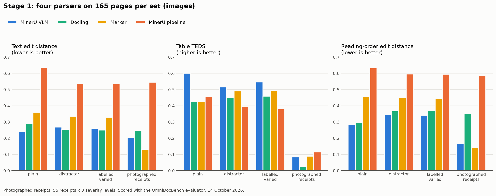
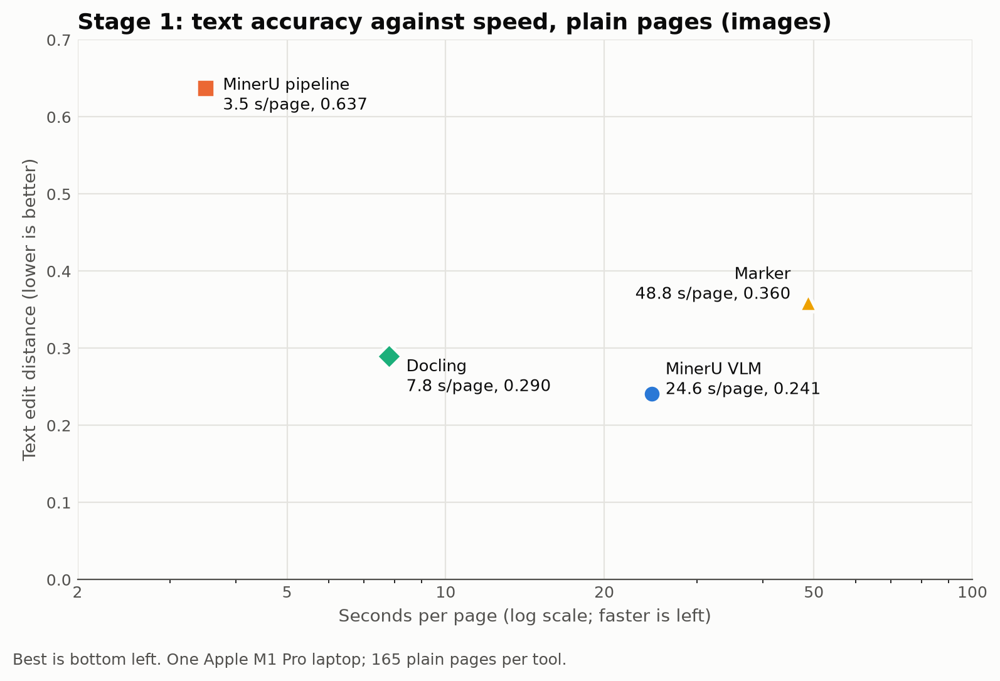

# MinerU and Docling: Generative AI, Stage 1 Results, and Native PDFs

Notes for the meeting, 15 October 2026.

## Is MinerU pipeline generative AI?

Generally no. MinerU pipeline is conventional machine learning, not generative AI in the usual sense. MinerU VLM
is generative AI.

**MinerU pipeline** chains specialised models that detect, classify and recognise rather than generate:

- **Layout detection** (a YOLO-style detector): finds and labels regions.
- **OCR** (PaddleOCR): reads the characters already on the page.
- **Table recognition**: predicts a table's structure.
- **Reading order**: sorts the regions.

Each model's output is limited to what is printed on the page. Nothing writes free text or invents content.

**One caveat for strict definitions:** a couple of components (table structure and formula recognition)
produce their output token by token, the way generative models do. If a policy defines generative AI purely by
model architecture, someone could argue those count. Most governance definitions are about models that create
new content, such as LLMs and VLMs, and by that test the pipeline is not generative.

**MinerU VLM** clearly is generative AI: a 1.2-billion-parameter vision-language model that looks at the page
and writes the markdown itself. It can hallucinate text that is not on the page, which the pipeline cannot.

| Tool | Generative AI? |
|---|---|
| MinerU pipeline | No (conventional ML and OCR) |
| MinerU VLM | Yes (vision-language model) |
| Docling (standard pipeline) | No (layout, table and OCR models) |
| Marker | Mostly no: built on Datalab's own OCR and layout models; newer versions can optionally call an LLM, which was not used here |
| Text-layer baseline | No (no model at all) |

If the organisation has a formal definition, check against its wording. Hallucination risk is often what such
policies care about, and the pipeline does not carry it.

## Which model MinerU VLM uses

MinerU VLM runs **MinerU2.5-Pro**, OpenDataLab's own document model, release `MinerU2.5-Pro-2605-1.2B`
(confirmed from the weights on the benchmark laptop, 2.2 GB, licensed Apache-2.0).

What it is built from (read from its `config.json`):

- **Architecture: Qwen2-VL** (`Qwen2VLForConditionalGeneration`), Alibaba's open vision-language design.
- **Vision encoder:** 32 layers, 1,280 wide, reading the page in 14-pixel patches: the part that sees the page.
- **Language decoder:** 24 layers, 896 wide (the size of Qwen2's 0.5-billion-parameter model): the part that
  writes the markdown.
- **About 1.2 billion parameters in total**, small for a vision-language model, which is why it runs on a
  laptop.

It is not a general chatbot model: OpenDataLab trained it on the Qwen2-VL design specifically to turn document
pages into markdown. In the benchmark it ran through MinerU 3.4.5's `vlm-engine` back-end, which on the Mac runs
the model through Apple's MLX framework on the laptop's GPU (25 to 35 seconds a page).

Two points for the discussion:

- It is the **generative** one of the two MinerU back-ends: its decoder writes the output text itself, so it can
  in principle produce text that is not on the page.
- It sits on a **Qwen (Alibaba) base**. Some AI policies care about a model's origin, so it may be worth noting.

## Docling, the third tool in the comparison

**Docling** (version 2.120.2) is an open-source document converter started at IBM Research and now hosted by
the LF AI & Data Foundation, licensed MIT. Its standard pipeline is, like MinerU pipeline, a chain of
specialised models rather than a generative one: a layout model, a table model (TableFormer) and OCR
(RapidOCR). It is not generative AI. It ran at 5 to 12 seconds a page on the same laptop.

## Stage 1 at a glance

## Stage 1: MinerU VLM, MinerU pipeline and Docling on images (PNG)

Scored 14 October 2026 on 165 pages per set (55 bank statements, 55 receipts, 55 tax invoices), with the
OmniDocBench evaluator, all three run on the same laptop (both MinerU back-ends from MinerU 3.4.5). The
degraded set is 55 receipts photographed at three severity levels. Bold marks the best of the three.

**Text edit distance** (lower is better; 0 is perfect)

| Tool | plain | distractor | labelled_varied | degraded |
|---|---|---|---|---|
| MinerU VLM | **0.241** | 0.269 | 0.261 | **0.203** |
| MinerU pipeline | 0.637 | 0.539 | 0.536 | 0.546 |
| Docling | 0.290 | **0.255** | **0.251** | 0.249 |

**Table TEDS** (higher is better; 1 is perfect)

| Tool | plain | distractor | labelled_varied | degraded |
|---|---|---|---|---|
| MinerU VLM | **0.601** | **0.516** | **0.547** | 0.085 |
| MinerU pipeline | 0.458 | 0.397 | 0.381 | **0.115** |
| Docling | 0.425 | 0.451 | 0.460 | 0.026 |

**Reading-order edit distance** (lower is better)

| Tool | plain | distractor | labelled_varied | degraded |
|---|---|---|---|---|
| MinerU VLM | **0.284** | **0.346** | **0.342** | **0.167** |
| MinerU pipeline | 0.634 | 0.596 | 0.595 | 0.586 |
| Docling | 0.297 | 0.368 | 0.371 | 0.351 |

**Time per page:** MinerU VLM 25 to 35 seconds; Docling 5 to 12 seconds; MinerU pipeline 3 to 9 seconds.

What it shows:

- MinerU VLM is the best overall: first on tables and reading order on every clean set, and on text on plain
  pages.
- **Docling is a close second on text**, and slightly better than MinerU VLM on cluttered pages (0.255 against
  0.269), while being about 2.5 to 7 times faster. Its weak point is tables: it reads 24 of the 55 plain invoices as one
  page-wide table and every receipt as one paragraph.
- MinerU pipeline is the weakest of the three on images, mostly because it reads very little of short receipt
  images: on 38 of the 55 plain receipts its text edit distance is above 0.8. It is also the fastest, about 3
  to 11 times faster than MinerU VLM depending on the set.
- On photographed receipts none of the three reads tables usefully (TEDS 0.03 to 0.12).

## MinerU on native PDFs: what to expect from stage 2

The two back-ends behave differently with PDFs, and that is one of the most interesting results to expect:

- **MinerU pipeline** reads the PDF's text layer directly, so it skips OCR. Its weak spot in stage 1 was reading
  text from images (text edit distance 0.637 on plain pages), so it may improve a lot.
- **MinerU VLM** always turns the page into an image and looks at it, even when given a PDF. Its PDF and image
  scores should be nearly the same, which is why the leaderboard will note it.
- **Docling** also reads a native PDF's text layer rather than running OCR, so, like the pipeline, it should
  gain on text; its table handling is the open question.

So native PDFs could narrow the gap between the two MinerU back-ends, or even reverse it, in which case the fast
pipeline (3 to 9 seconds a page) would be the better choice for native PDFs. That is the routing question stage
2 is built to answer.
