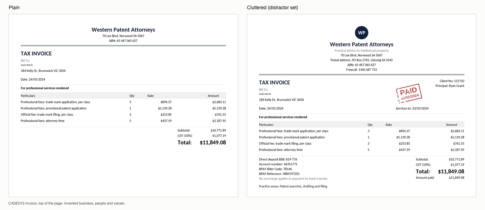
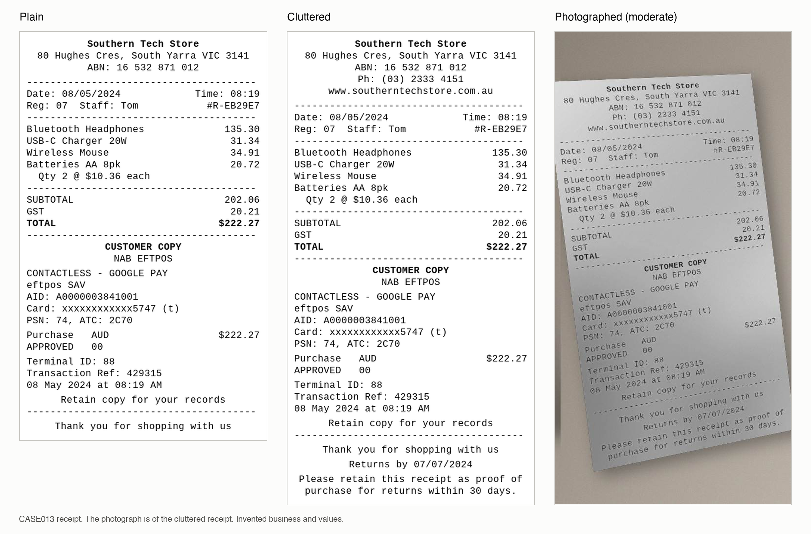
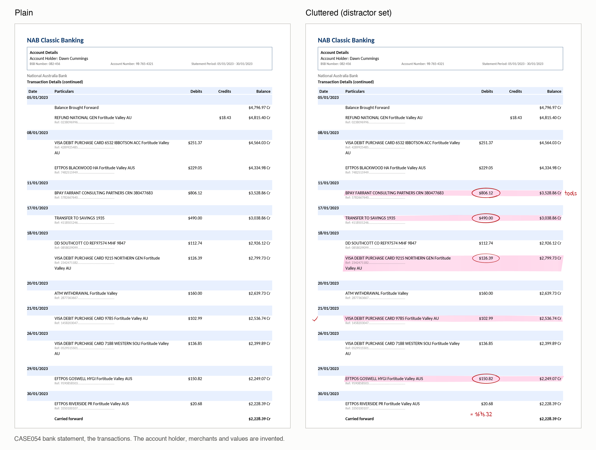

# Parsing Benchmark Notes

MinerU, Docling and Marker: generative AI, stage 1 results on images, and stage 2 results on native PDFs.

## Is MinerU pipeline generative AI?

Generally no. MinerU pipeline is conventional machine learning, not generative AI in the usual sense. MinerU VLM
is generative AI.

**MinerU pipeline** chains specialised models that detect, classify and recognise rather than generate:

- **Layout detection** (a YOLO-style detector): finds and labels regions.
- **OCR** (PaddleOCR): reads the characters already on the page.
- **Table recognition**: predicts a table's structure.
- **Reading order**: sorts the regions.

Each model's output is limited to what is printed on the page. Nothing writes free text or invents content.

**One caveat for strict definitions:** a couple of components (table structure and formula recognition)
produce their output token by token, the way generative models do. If a policy defines generative AI purely by
model architecture, someone could argue those count. Most governance definitions are about models that create
new content, such as LLMs and VLMs, and by that test the pipeline is not generative.

**MinerU VLM** clearly is generative AI: a 1.2-billion-parameter vision-language model that looks at the page
and writes the markdown itself. It can hallucinate text that is not on the page, which the pipeline cannot.

| Tool | Generative AI? |
|---|---|
| MinerU pipeline | No (conventional ML and OCR) |
| MinerU VLM | Yes (vision-language model) |
| Docling (standard pipeline) | No (layout, table and OCR models) |
| Marker | Mostly no: built on Datalab's own OCR and layout models; newer versions can optionally call an LLM, which was not used here |
| Text-layer baseline | No (no model at all) |

If the organisation has a formal definition, check against its wording. Hallucination risk is often what such
policies care about, and the pipeline does not carry it.

## Which model MinerU VLM uses

MinerU VLM runs **MinerU2.5-Pro**, OpenDataLab's own document model, release `MinerU2.5-Pro-2605-1.2B`
(confirmed from the weights on the benchmark laptop, 2.2 GB, licensed Apache-2.0).

What it is built from (read from its `config.json`):

- **Architecture: Qwen2-VL** (`Qwen2VLForConditionalGeneration`), Alibaba's open vision-language design.
- **Vision encoder:** 32 layers, 1,280 wide, reading the page in 14-pixel patches: the part that sees the page.
- **Language decoder:** 24 layers, 896 wide (the size of Qwen2's 0.5-billion-parameter model): the part that
  writes the markdown.
- **About 1.2 billion parameters in total**, small for a vision-language model, which is why it runs on a
  laptop.

It is not a general chatbot model: OpenDataLab trained it on the Qwen2-VL design specifically to turn document
pages into markdown. In the benchmark it ran through MinerU 3.4.5's `vlm-engine` back-end, which on the Mac runs
the model through Apple's MLX framework on the laptop's GPU (25 to 35 seconds a page).

Two points for the discussion:

- It is the **generative** one of the two MinerU back-ends: its decoder writes the output text itself, so it can
  in principle produce text that is not on the page.
- It sits on a **Qwen (Alibaba) base**. Some AI policies care about a model's origin, so it may be worth noting.

## Docling, the third tool in the comparison

**Docling** (version 2.120.2) is an open-source document converter started at IBM Research and now hosted by
the LF AI & Data Foundation, licensed MIT. Its standard pipeline is, like MinerU pipeline, a chain of
specialised models rather than a generative one: a layout model, a table model (TableFormer) and OCR
(RapidOCR). It is not generative AI. It ran at 5 to 12 seconds a page on the same laptop.

## What "cluttered pages" means

"Cluttered pages" is shorthand for the **distractor set** (and the labelled_varied set built on it): the same
165 documents as the plain set, with extra content drawn on that a reader must not mistake for the real fields,
the kind of noise real business documents carry.

**What gets added** (all invented, and checked never to equal a real field value):

- **Near-miss values:** an ACN printed beside the ABN, a due date beside the invoice date, a store or branch
  number, other amounts that look like totals.
- **Extra printed text:** reference numbers, contact lines, notes.
- **Annotations, drawn as if by hand:** on bank statements, handwritten margin notes and totals, ink ticks
  against rows and highlighter over transactions; on invoices, a "PAID" stamp.

**Examples** (every business, person and value is invented):

The cluttered invoice adds a logo, a tagline, a postal address, a phone line, a client number and principal,
a "Services to" date beside the invoice date, payment details, an "Amount paid" line beside the total, and a
rotated "PAID" stamp, all of which a parser must read and place in order.

The cluttered receipt adds a phone number, a website and returns lines; the photographed set shows that
cluttered receipt shot at an angle on a desk, the moderate of three severity levels.

The cluttered statement carries the annotations only bank statements get, drawn as if by hand: highlighter over
five transactions, red circles round their amounts, a tick in the margin, a handwritten note ("tools") beside a
row and a handwritten running total ("= 1676.32"). A parser must read the printed rows through the
highlighting, and either transcribe or ignore the handwriting without mixing it into the table. The account
holder, merchants and values are invented; the bank's name is real, since each statement layout imitates a real
Australian bank's.

**How much more is on the page** (average per page):

| | Plain | With distractors |
|---|---|---|
| Invoice | 12 blocks, about 220 characters | 37 blocks, about 930 characters |
| Receipt | 24 blocks | 30 blocks |
| Bank statement | 7 blocks | 10 blocks |

**Why it exists:** comparing plain with distractor pages shows how much clutter costs each tool. For parsing,
every added item is real text the tool must transcribe and place in the right reading order, so a busier page is
harder to read in full. (For the extraction benchmark the set was first built for, the point was to tempt a
model into picking the wrong value.)

**What stage 1 showed:**

- **Text accuracy barely suffered,** and for MinerU pipeline, Docling and Marker it slightly improved: the extra
  text is mostly clean printed lines, easy to read, which dilute the hard parts.
- **Reading order got worse for the two best readers,** MinerU VLM (0.284 to 0.346) and Docling (0.297 to
  0.368): more blocks mean more chances to put them in the wrong order. It barely moved for MinerU pipeline and
  Marker, whose reading order was already weak.
- **Docling handled the clutter best on text** (0.255 against MinerU VLM's 0.269).

## Stage 1 at a glance

## Stage 1: MinerU VLM, MinerU pipeline and Docling on images (PNG)

Scored 14 October 2026 on 165 pages per set (55 bank statements, 55 receipts, 55 tax invoices), with the
OmniDocBench evaluator, all three run on the same laptop (both MinerU back-ends from MinerU 3.4.5). The
degraded set is 55 receipts photographed at three severity levels. Bold marks the best of the three.

**Text edit distance** (lower is better; 0 is perfect)

| Tool | plain | distractor | labelled_varied | degraded |
|---|---|---|---|---|
| MinerU VLM | **0.241** | 0.269 | 0.261 | **0.203** |
| MinerU pipeline | 0.637 | 0.539 | 0.536 | 0.546 |
| Docling | 0.290 | **0.255** | **0.251** | 0.249 |

**Table TEDS** (higher is better; 1 is perfect)

| Tool | plain | distractor | labelled_varied | degraded |
|---|---|---|---|---|
| MinerU VLM | **0.601** | **0.516** | **0.547** | 0.085 |
| MinerU pipeline | 0.458 | 0.397 | 0.381 | **0.115** |
| Docling | 0.425 | 0.451 | 0.460 | 0.026 |

**Reading-order edit distance** (lower is better)

| Tool | plain | distractor | labelled_varied | degraded |
|---|---|---|---|---|
| MinerU VLM | **0.284** | **0.346** | **0.342** | **0.167** |
| MinerU pipeline | 0.634 | 0.596 | 0.595 | 0.586 |
| Docling | 0.297 | 0.368 | 0.371 | 0.351 |

**Time per page:** MinerU VLM 25 to 35 seconds; Docling 5 to 12 seconds; MinerU pipeline 3 to 9 seconds.

What it shows:

- MinerU VLM is the best overall: first on tables and reading order on every clean set, and on text on plain
  pages.
- **Docling is a close second on text**, and slightly better than MinerU VLM on cluttered pages (0.255 against
  0.269), while being about 2.5 to 7 times faster. Its weak point is tables: it reads 24 of the 55 plain invoices as one
  page-wide table and every receipt as one paragraph.
- MinerU pipeline is the weakest of the three on images, mostly because it reads very little of short receipt
  images: on 38 of the 55 plain receipts its text edit distance is above 0.8. It is also the fastest, about 3
  to 11 times faster than MinerU VLM depending on the set.
- On photographed receipts none of the three reads tables usefully (TEDS 0.03 to 0.12).

## Stage 2: native PDFs, what we found

About half the documents received are native PDFs (files with a text layer, not scans), mostly the same kinds
as stage 1's. Stage 2 typeset the same 165 documents as native PDFs, plain and cluttered (330 pages), and scored
the tools on them on 16 October 2026. Marker was not run on PDFs (dropped for stage 2; its stage 1 image
results stand). A new entry, the **text layer**, simply reads the text the PDF already contains, with no model.

**Scores on native PDFs** (plain / cluttered)

| Tool | Text edit distance (lower is better) | Table TEDS (higher is better) | Reading order (lower is better) |
|---|---|---|---|
| **Text layer (no model)** | **0.009 / 0.051** | 0.000 (no tables) | **0.105 / 0.099** |
| MinerU VLM | 0.253 / 0.282 | **0.598 / 0.492** | 0.315 / 0.365 |
| Docling | 0.333 / 0.262 | 0.492 / 0.461 | 0.353 / 0.376 |
| MinerU pipeline | 0.619 / 0.528 | 0.471 / 0.428 | 0.635 / 0.570 |

What it shows, on these synthetic documents:

- **For text and reading order, reading the text layer beats every model by a wide margin:** almost perfect text
  (0.009 on plain pages), in under a second for all 165 pages, on no GPU.
- **The text layer gives no table structure.** For tables, MinerU VLM is best, then Docling, then MinerU pipeline.
- **So a native PDF is best routed to the text layer for text and reading order, and to a table model (MinerU
  VLM) where table structure matters.** Scans and photos still need a full parser.

**Table gains from a native PDF over an image** (each tool's PDF score against its stage 1 image score; TEDS,
plain / cluttered; positive means the PDF helped)

| Tool | Table TEDS gain |
|---|---|
| Docling | +0.068 / +0.011 |
| MinerU pipeline | +0.012 / +0.030 |
| MinerU VLM | -0.003 / -0.024 |

Text gains are deliberately not reported. A control run (Docling on images of the stage 2 pages) showed the new
rendering alone moves text scores by 0.028, more than the 0.02 allowed, so a text gain would mix the change of
rendering with the change of input. Table scores moved less (0.019), within the allowance; even so, Docling's
true table gain may be nearer +0.05.

**How the earlier expectations held up:**

- **MinerU pipeline did not close the gap.** It does read the PDF's text layer (OCR switched off), yet still
  scores 0.619 on text against the text layer's 0.009, which suggests its layout step, not character reading,
  limits it. The fast pipeline is not the answer for native PDFs; the text layer is.
- **MinerU VLM behaved as expected:** it turns the PDF into an image and reads that, so its table scores barely
  moved (-0.003 on plain pages). It remains the best table reader.
- **Docling gained most on tables** (+0.068 on plain pages), as it reads the PDF's own text cells.
